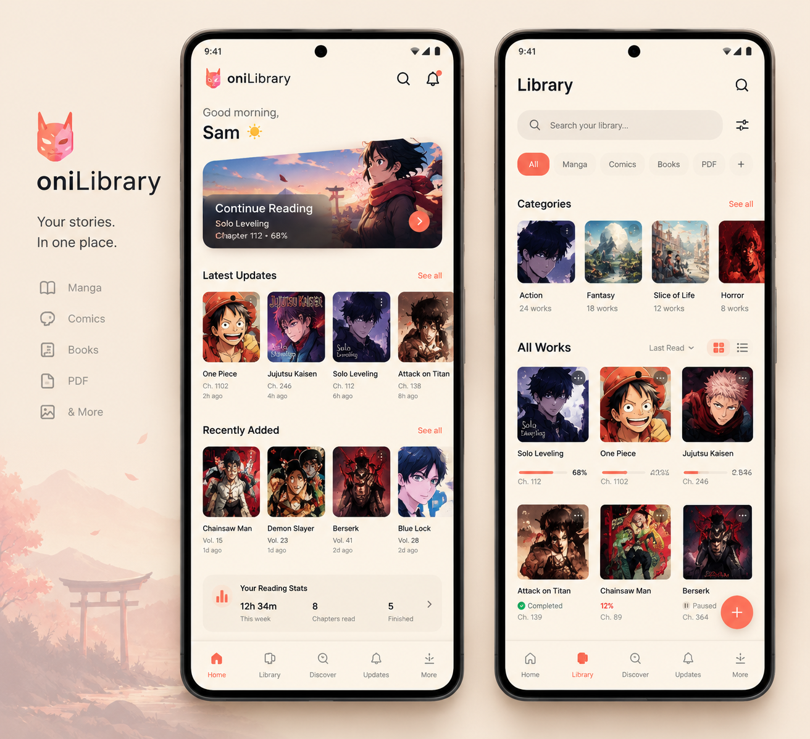
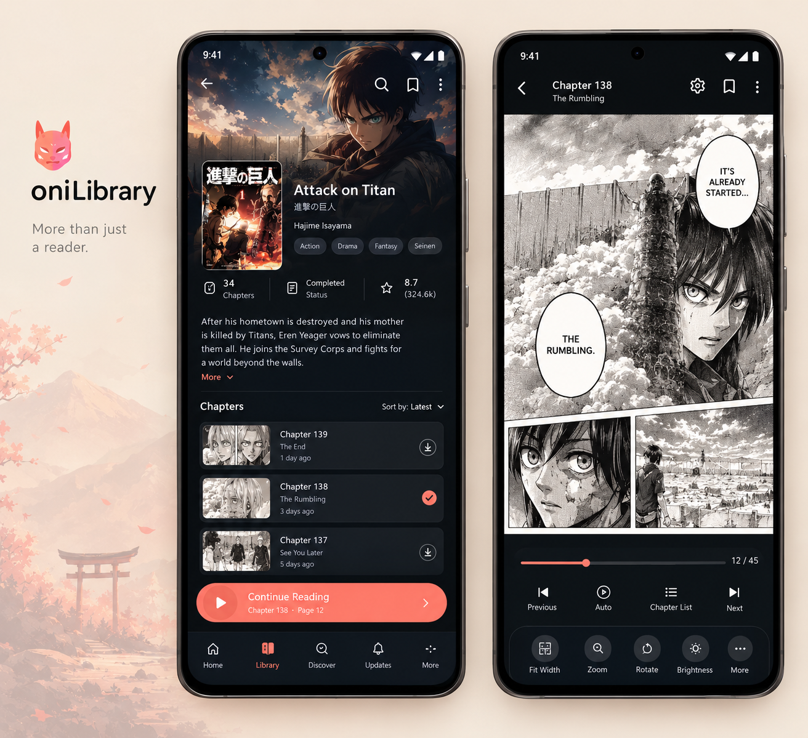
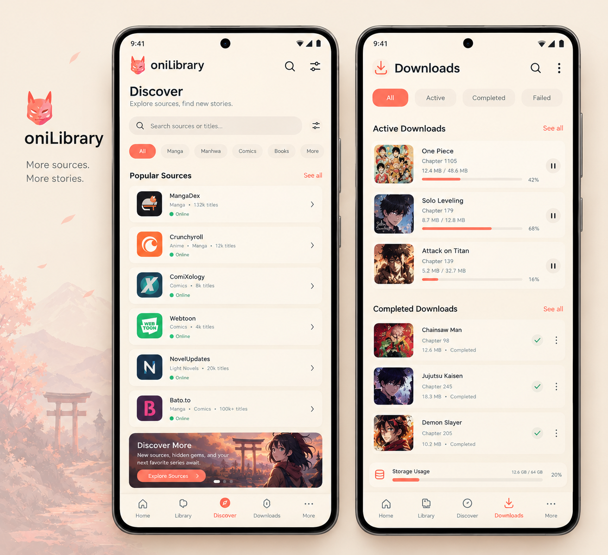
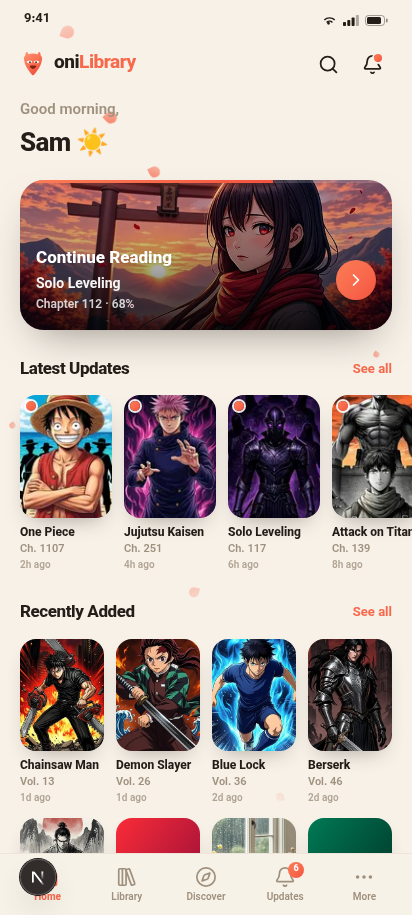
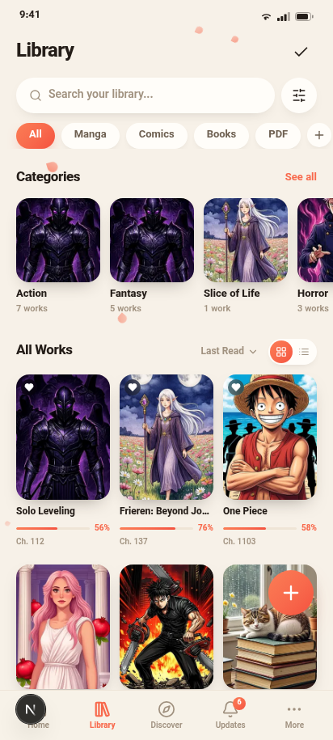
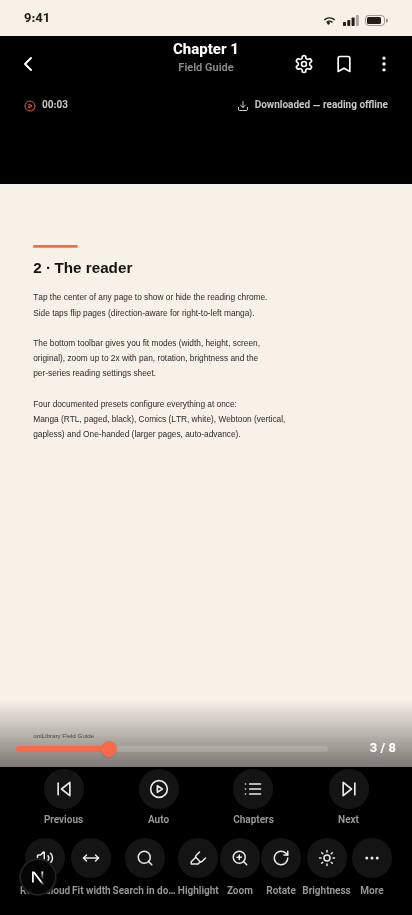

<div align="center">

# 📖 oniLibrary

**Your stories. In one place.**

A modern, fully-offline reader for **manga · comics · webtoons · PDFs · e-books** —
shipped as an Android app (WebView shell) and an installable PWA built with Next.js.

  

  

</div>

---

## ✨ Highlights

| | Feature |
|---|---|
| 📚 | **Multi-format reader** — manga (RTL, paged), comics (LTR, white), webtoons (vertical, gapless), PDF documents, EPUB e-books |
| 🎨 | **Reader engine** — fit modes (width/height/screen/original), zoom up to 2× with pan, brightness, per-series presets, one-handed auto-advance |
| 🔍 | **EPUB full-text search**, chapter navigation, adjustable fonts & themes for books |
| 🔊 | **Read-aloud (TTS)** — paragraph-chunked queue with native Android voice bridge |
| 🗂️ | **Library management** — categories, smart categories with live rules (status / type / downloaded / unread / favorite), saved filters, dedup assistant, vault (hidden works) |
| ⬇️ | **Downloads & import** — CBZ/ZIP, image batches, PDF, EPUB import; storage estimation; background-ready download jobs |
| 📊 | **Statistics** — reading time, chapters, streaks, daily goal ring, 14-day heatmap |
| 🌐 | **Bilingual UI** — English + فارسی (Persian, full RTL) |
| 🌓 | **Light / Dark / System** themes, warm paper palette |
| 📴 | **100% offline** — all data stays on-device (localStorage + IndexedDB). No accounts, no tracking |

## 📱 Screenshots

| Home | Library | Reader |
|---|---|---|
|  |  |  |

## 🚀 Quick start (Android)

1. Grab the latest APK from **[Releases](https://github.com/onimeno62/oniLibrary/releases)** — or from [`download/`](download) in this repo.
2. On your phone, allow *Install unknown apps* for your browser/file manager (Android will ask once).
3. Install **`oniLibrary-v1.1.1.apk`** (minSdk 24 → Android 7.0+, target 34).
4. Done — no permissions requested beyond network (used only for optional online sources).

> Upgrades install in place: releases are signed with the same key, versionCode always increases.

## 🖥️ Run the web app (development)

```bash
bun install          # or npm/pnpm install
bun run dev          # http://localhost:3000
bun run lint         # eslint
```

The same UI runs as a PWA in any browser; the Android app is a thin native shell
(`MainActivity.java`) around a static export of it.

## 📦 Build the APK yourself

See **[docs/BUILDING.md](docs/BUILDING.md)** for the full guide. Short version:

```bash
bash scripts/setup-android-sdk.sh        # once — SDK 34 + build-tools
bash scripts/build-apk.sh --fresh        # static export → aapt2 → ecj → d8 → sign
node scripts/verify-apk-assets.cjs       # sanity: every bundled URL resolves
# → download/oniLibrary-v<version>.apk
```

No Gradle involved — a lean pipeline that produces a ~4.3 MB APK.
A **GitHub Actions workflow** (`.github/workflows/apk.yml`, manual trigger) builds it in CI too.

## 🗺️ Project map

```
├─ src/app/                 Next.js App Router (single-page reader app)
├─ src/components/          UI: screens, shared components, onboarding
├─ src/lib/                 engine: store (zustand), importer, pdf-engine,
│                           local-files (IndexedDB), tts, i18n, types…
├─ android/app/             native shell: MainActivity (WebView + JS bridge),
│                           manifest, res, assets/www (bundled export)
├─ scripts/                 build-apk.sh · verify-apk-assets.cjs · sample generators
├─ docs/                    PRD · BUILDING · ARCHITECTURE · design mockups · screenshots
└─ download/                ready-to-install APKs
```

## 📚 Documentation

- [Product Requirements (PRD v2)](docs/PRD.md)
- [Architecture](docs/ARCHITECTURE.md)
- [Building & signing](docs/BUILDING.md)
- [Changelog](CHANGELOG.md)

## 🧭 Roadmap ideas

- Online catalogue sources (pluggable, PRD §5)
- Cloud backup / restore of `.onibackup` archives
- OPDS browsing, per-chapter preloading
- Tablet / two-page landscape layout

## 📄 License

[MIT](LICENSE) — free to read, fork and enjoy. All artwork in mockups/screenshots
belongs to its respective owners and is used as design reference placeholders.
